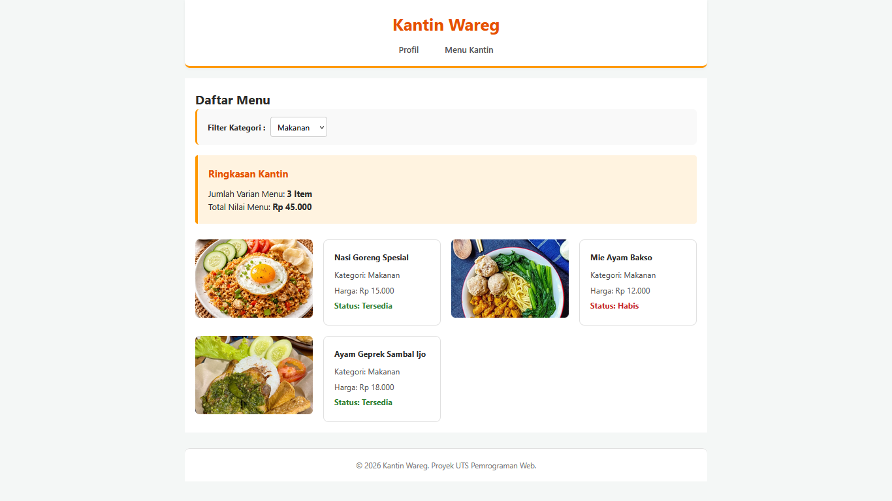
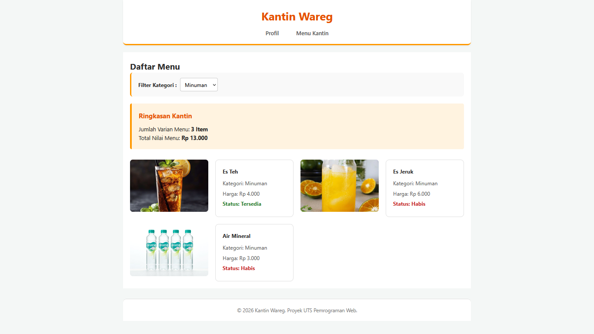
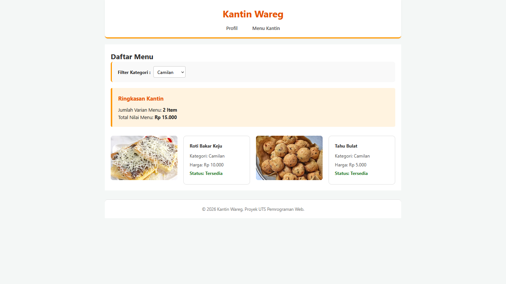

# UTS Pemrograman Web - Katalog Kantin

## 1. Identitas
- **Nama** : Viona Zulaikha Al Khusniah
- **NIM**  : 025A00200001
- **Kelas** : A2-3A

## 2. Deskripsi Singkat Tema
Proyek ini adalah website profil dan katalog dinamis untuk Kantin Wareg. Data disimpan dalam bentuk array multidimensi pada file `data.php` (belum menggunakan database). Tampilan dibuat menggunakan HTML semantik dan CSS murni.

## 3. Cara Menjalankan di Localhost
1. Pastikan aplikasi Laragon sudah terinstall dan berjalan.
2. Karena keterbatasan pada folder `www` bawaan, proyek ini diletakkan di direktori root lain (F:/cod/smt 3/WEB).
3. Menggunakan fitur **Root** agar Laragon mengenali folder proyek tersebut.
4. Setelah server (Apache/PHP) berjalan, akses halaman profil melalui URL yang tertera di Laragon.
5. Halaman katalog dapat diakses dengan mengklik menu navigasi atau membuka `katalog.php`.

## 4. Daftar Fitur dan Nama fungsi
- **Halaman Profil (`index.php`) :** Menampilkan informasi umum dan pengantar tema kantin.
- **Fungsi `formatRupiah()` :** Terdapat di `functions.php`, berfungsi untuk mengubah angka menjadi format rupiah.
- **Fungsi `cekKetersediaan()` :** Terdapat di `functions.php`, menggunakan percabangan `match` untuk memberi label "Tersedia" atau "Habis".
- **Fungsi `hitungTotalHarga()` :** Terdapat di `functions.php`, menghitung total harga dari semua menu didalam array.
- **Fungsi `hitungJumlahMenu()` :** Terdapat di `functions.php`, menghitung jumlah varian menu yang ada.
- **Fungsi `e()` :** Terdapat di `functions.php`, pembungkus `htmlspecialchars` untuk mencegah serangan XSS (Cross-Site Scripting).

## 5. Daftar Fungsi Array Bawaan yang Dipakai
1. `number_format()` -> Digunakan di fungsi `formatRupiah`, memformat angka menjadi format ribuan dengan titik.
2. `array_column()` -> Digunakan di fungsi `hitungTotalHarga`, mengambil semua nilai `harga` dari array multidimensi.
3. `array_sum()` -> Digunakan di fungsi `hitungTotalHarga`, menjumlahkan total semua angka dari hasil `array_column`.
4. `count()` -> Digunakan di fungsi `hitungJumlahMenu`, menghitung jumlah item menu.
5. `array_filter()` -> Digunakan di fungsi `katalog.php` untuk menyaring data menu sesuai kategori yang dipilih pada dropdown filter.

## 6. Tangkapan Layar 
**Halaman Profil :**

**Halaman Katalog :**

## 7. Sumber Referensi dan Catatan Penggunaan AI
- **Sumber Referensi Utama :** Materi kuliah pemrograman web (peretemuan 1-7) dan modul praktikum.
- **Catatan Penggunaan AI :** Saya menggunakan bantuan AI (Deepseek) selama proses pengerjaan proyek ini sebagai berikut :
1. **Setup Git & GitHub :** Memandu langkah-langkah inisialisasi repositori, commit, hingga push dari awal.
2. **Struktur Kode Dasae :** Membantu merancang struktur dasar file.
3. **Debugging & Perbaikan error :** Membantu menemukan solusi saat terjadi *error* (seperti *Parse error* pada array, gambar yang tidak muncul karena tag tidak tertutup, dan perbaikan logika filter `array_filter`).
4. **Penyempurnaan Tampilan (CSS) :** Membantu memberikan saran CSS agar tata letak (layout) rapi dan responsif.

Seluruh kode yang disarankan oleh AI sudah saya ketik ulang, sudah diuji coba sendiri di browser lokal, dan dipahami alur logikanya.